# WindowSmith Architecture

Reflects WindowSmith 1.4.1 (build 27).

```mermaid
graph TD
    %% Define Styles
    classDef ui fill:#0f4c75,stroke:#3282b8,stroke-width:2px,color:#fff,rx:5px,ry:5px;
    classDef core fill:#1b262c,stroke:#bbe1fa,stroke-width:2px,color:#fff,rx:5px,ry:5px;
    classDef sys fill:#3282b8,stroke:#0f4c75,stroke-width:2px,color:#fff,rx:5px,ry:5px;
    classDef net fill:#16213e,stroke:#9d8cff,stroke-width:2px,color:#fff,rx:5px,ry:5px;
    classDef target fill:#1a1a2e,stroke:#e94560,stroke-width:3px,color:#fff,rx:10px,ry:10px;

    subgraph UI ["User Interface (SwiftUI)"]
        App["WindowSmithApp<br/>@main · MenuBarExtra(.window)"]
        MenuBarView["MenuBarView"]
        Overlay["PermissionOverlay"]
        SWM["SettingsWindowManager<br/>NSWindow + NSHostingController"]
        SettingsView["SettingsView<br/>General · Shortcuts · Mouse · My Layouts tabs"]
        Snap["SnapLayoutView"]
        Cell["PresetCell"]
        Grid["GridBuilderView<br/>cell selection · grouping"]
        Preview["SnapPreviewOverlay<br/>borderless · click-through NSWindow"]
        Guides["EdgeGuideOverlay<br/>click-through · full screen · lit zone"]
        Palette["ZoomPalettePanel<br/>non-activating NSPanel · Liquid Glass · rebuilt per open"]

        App -->|hosts| MenuBarView
        MenuBarView -->|when untrusted| Overlay
        MenuBarView -->|renders| Snap
        MenuBarView -->|renders| Cell
        MenuBarView -->|opens| SWM
        SWM -->|hosts| SettingsView
        SettingsView -->|renders| Grid
        Palette -->|renders| Snap
    Palette -->|Saved grids · first 8| LM
    end

    subgraph Core ["Core Engine (Swift)"]
        WC["WindowController<br/>singleton · ObservableObject"]
        HK["HotKeys<br/>Carbon RegisterEventHotKey · exclusive"]
        UPD["UpdaterController<br/>wraps SPUStandardUpdaterController · automatic-check switch · relaunch watcher"]
        RM["RestoreMemory<br/>each window's frame before WindowSmith moved it"]

        subgraph WC_Logic ["WindowController Internals"]
            Geo["Geometry Engine<br/>relative rects · throw"]
            Perm["Permission Watch<br/>trust notification + 1s poll"]
            Cycle["Cycle State<br/>5s arrow-key timeout"]
        end

        DSM["DragSnapMonitor<br/>global mouse monitors · drag detection"]
        DSS["DragSnapSettings<br/>mode · layout · trigger · enabled · first-launch defaults"]
        ES["EdgeSnap<br/>edge and corner zones · guide shapes"]
        AT["AppleTiling<br/>reads macOS's own tiling settings"]
        WL["WindowLookup<br/>window at point · coordinate flips"]
        LM["Layout Model<br/>Preset.layout · GridMerges.blocks"]
        MATH["SnapMath<br/>placement arithmetic · plain rects in, rects out"]
        ZPM["ZoomPaletteMonitor<br/>pointer resting on a green button · saved button corners"]
        ZPS["ZoomPaletteSettings<br/>one switch · palette + Apple's menu · restored on quit"]

        UD[("UserDefaults<br/>presets · hotkeys · drag-snap · green button · block visibility · settings tab · prompt flag")]
    end

    subgraph MacOS ["macOS System APIs"]
        AX["Accessibility API (AXUIElement)<br/>answered by the owning app"]
        CGW["CGWindowList<br/>answered by the WindowServer"]
        WS["NSWorkspace<br/>frontmost app · wake"]
        CG["NSScreen / CoreGraphics<br/>display bounds"]
        GCD["Grand Central Dispatch<br/>userInteractive queue"]
        SM["SMAppService<br/>Launch at Login"]
        DNC["DistributedNotificationCenter<br/>com.apple.accessibility.api"]
        OSL["OSLog"]
        GP["Global preferences<br/>NSZoomButtonShowMenu"]
        WMP["com.apple.WindowManager<br/>EnableTilingByEdgeDrag · EnableTopTilingByEdgeDrag"]
        CEV["Carbon Event Manager<br/>hot keys · input source changes"]
    end

    subgraph Updates ["Update Channel"]
        SPK["Sparkle 2.10<br/>embedded framework"]
        Feed["appcast.xml<br/>EdDSA-signed feed"]
    end

    subgraph Target ["Target Environment"]
        TA["Third-Party OS Window<br/>(Safari, Xcode, etc.)"]
    end

    %% UI to Core
    MenuBarView -->|Triggers Snap / Layout| WC
    SettingsView -->|Saves Presets & Hotkeys| WC
    Overlay -->|Grant Access| Perm
    MenuBarView -->|Check for Updates| UPD
    SettingsView -->|Automatic checks on / off| UPD
    WC <-->|Combine @Published Updates| MenuBarView
    WC <-->|Persists / Loads| UD
    WC -->|Toggles| SM

    %% Core internals
    CEV == "Ctrl+Opt 1-4 · arrows · C · Delete" ==> HK
    HK == "Layout · cycle / throw · center · restore" ==> WC
    WC -->|Frame before and after each move| RM
    WC --> Geo
    WC --> Cycle
    WC --> Perm
    WC --> OSL
    DNC -.->|AX trust changed| Perm
    Perm -.->|Starts mouse watchers on grant| DSM

    %% Core to OS
    WC -->|Queries Frontmost PID| WS
    WC -->|Queries visibleFrame| CG
    Geo == "Dispatches Async Resize/Move" ==> GCD
    GCD == "Injects Coordinates (checked and retried)" ==> AX
    AX == "Translates & Modifies Frame" ==> TA

    %% Drag to snap
    SettingsView -->|Configures| DSS
    DSS -.->|Arms / disarms| DSM
    DSM -->|Which window is moving| WL
    WL -->|Live frame during a drag · window under the pointer| CGW
    WL -->|Element to move · green button · fallback frame| AX
    DSM -->|Previews the target zone| Preview
    DSM -->|Screen edges mode: zone under the pointer| ES
    DSM -->|Shows and lights the edges| Guides
    DSM -->|Dragging a snapped window away: original size| RM
    MenuBarView -->|Warns when on| AT
    SettingsView -->|Warns when on| AT
    AT -->|Reads, never writes| WMP
    DSM == "Applies the drop to that exact window" ==> WC
    WS -.->|Wake · display change: rebuild| Preview

    %% One zone decomposition for every consumer
    WC -->|resolveLayout| LM
    Cell -->|preset.layout| LM
    SettingsView -->|preset.layout| LM
    Grid -->|Draws the same blocks| LM

    %% One placement calculation for every consumer
    Geo -->|Zone rects · size presets · arrow-key wrap| MATH
    DSM -->|Zone under the cursor · near-edge test| MATH

    %% Green-button palette
    SettingsView -->|Asks, then configures| ZPS
    ZPS -.->|Arms / disarms| ZPM
    ZPS -->|Hides / restores Apple's menu| GP
    ZPM -->|Every window's button corner, at most once a second| CGW
    ZPM -->|Window and button under the pointer| WL
    ZPM -->|Opens beside the button| Palette
    ZPM == "Places that exact window" ==> WC

    %% Updates
    UPD --> SPK
    UPD -.->|Update relaunch: keep Apple's menu hidden| ZPS
    SPK -.->|Polls & verifies signature| Feed

    %% Assign Classes
    class App,MenuBarView,Overlay,SWM,SettingsView,Snap,Cell,Grid,Preview,Guides,Palette ui;
    class WC,HK,UPD,RM,Geo,Perm,Cycle,UD,WC_Logic,DSM,DSS,ES,AT,WL,LM,MATH,ZPM,ZPS core;
    class AX,WS,CG,GCD,SM,DNC,OSL,CGW,GP,WMP,CEV sys;
    class SPK,Feed net;
    class TA target;
```

## Notable Mechanisms

**Primary-display coordinate anchoring.** AppKit measures from the bottom-left of the primary display; the Accessibility API measures from the top-left. Every conversion is anchored to the display whose origin is `(0,0)` rather than `NSScreen.main`, which follows the key window and therefore reports a different — and differently sized — screen whenever the target window sits on a secondary monitor.

**Permission detection without polling the user.** A menu bar app never receives `didBecomeActive` when the user flips the Accessibility switch in System Settings, so trust changes arrive two ways: an observer on the `com.apple.accessibility.api` distributed notification, plus a 1-second timer that runs only while untrusted and invalidates itself on grant. The timer is scheduled in `.common` run loop mode so it keeps firing while the menu bar popover is open.

**Shortcuts that belong to WindowSmith.** Since 1.4.0 the shortcuts are Carbon hot keys (`RegisterEventHotKey` with `kEventHotKeyExclusive`), not a global `NSEvent` monitor. A global monitor only listens: the key press still reached the app in front, so ⌃⌥1 could also type into it. A hot key is consumed, and it needs no Accessibility permission to be heard, so the grant no longer has to re-arm anything. Each action is registered by key code with `controlKey | optionKey` - 1-4 on both the number row and the keypad, the arrows, C and Delete - so the modifier and caps-lock clean-up the old monitor needed is gone. C is looked up through `UCKeyTranslate` in the keyboard layout in use, so Center follows the key marked C on any layout, and every key is registered again when the input source changes. If another app already holds a combination, registration fails for that key alone; an action counts as unavailable only if none of its keys could be had, and Settings marks it.

**Two disagreeing answers to "where is this window".** A title-bar drag is carried out by the WindowServer, not by the application — which is why a hung app's window can still be dragged. The Accessibility API asks the *owning application* for its position, so during a drag it returns a stale value and then jumps, measured at roughly 105ms behind the cursor across repeated drags. `CGWindowList` asks the WindowServer instead and tracks the cursor essentially 1:1. Drag detection therefore reads the WindowServer, which also cannot be stalled by an unresponsive app the way synchronous Accessibility IPC into that app's run loop can. The two sources are checked for agreement at mouse-down, and detection falls back to Accessibility if they disagree, so a mismatch can never move the wrong window.

**Distinguishing a window drag from a drag inside a window.** Nothing announces that a window drag has begun, so a candidate window is captured on mouse-down and promoted only once its frame actually moves while its size holds steady — a changed size means a resize handle, not a title bar. Cursor distance cannot make this call: the reported position lags far behind the pointer before catching up, so "the cursor moved but the window has not" describes an ordinary drag just as well as a text selection. Only elapsed time separates them, and nothing is drawn before the gesture is confirmed, so waiting costs a few extra probes and no visible latency.

**Desktop widgets are not windows to snap.** Widgets on the desktop belong to Notification Center and sit far below the normal window layer (around -2147483601, against 0 for app windows). The WindowServer lookup at mouse-down only accepts layer-0 windows, so it skips a widget, but the Accessibility fallback answers with the widget's window like any other, and dragging a widget really does move that window. Before 1.3.10 that made a widget pass as a window drag and get snapped on release. Mouse-down now asks the WindowServer which window is topmost under the pointer, and if it sits below the normal layer (a widget, a desktop icon, the wallpaper) the press is ignored outright. Floating windows above layer 0 are unaffected.

**A preview that cannot swallow its own gesture.** The zone preview is a borderless, transparent `NSWindow` above the normal window level. It sits directly under the cursor for the entire drag, so it sets `ignoresMouseEvents` — without that it would consume the very drag it exists to illustrate.

**A preview that survives a long sleep.** The preview window is created once and reused, and it joins every Space. After a long lid-closed sleep the Mac wakes from Deep Idle, treats the display as new hardware and rebuilds its Spaces, and a hidden window can come out of that belonging to none: ordering it front then reports success and shows nothing, indefinitely. So a hidden preview window is discarded on wake and on any display change, and every time it is shown it is asked whether it actually landed on the active Space; if not, it is replaced on the spot.

**One zone decomposition.** A saved grid is rows, columns and an optional list of grouped blocks. `Preset.layout` is the only place that turns that into zones, and it does so through `GridMerges.blocks` - the same function the Custom Grid Builder draws from. The hotkey, the arrow-key cycle, drag-to-snap, both miniatures, the green-button palette and the builder therefore cannot disagree about a layout's shape: there is one answer, not a copy of the arithmetic for each. Zones come out in row-major order with each group at its top-left cell, and that order is what the arrow keys walk.

**One setting for how the blocks look.** Every miniature is the same `SnapLayoutView`, so how strongly its blocks stand out is decided in one place. Block visibility in Settings offers Less, Normal and More: Less is the system separator color every version before 1.3.8 used, while Normal (the default) and More fill with the text color at 22% and 32% in dark mode, 13% and 16% in light. The choice is saved in UserDefaults and each miniature reads it through `@AppStorage`, so changing it redraws the menu bar, the green-button palette and Settings at once, with nothing to pass between them. A saved value it does not recognise reads as Normal.

**Groups stay on the grid.** A group is stored as integer grid coordinates, never as a fraction of the screen, so every edge it has is a k/rows or k/cols line - the same lines the ungrouped cells sit on. Built-in layouts follow the same rule: Bias is exactly two thirds rather than 0.66, which had left a 23px strip between a Bias window and a Thirds window on an ultrawide. Stored groups are clamped to the grid before use, since shrinking the builder under a group would otherwise leave a hole in the layout - and a hole shows up only as drag-to-snap declining to preview over it.

**Screen edges.** Drag to Snap has two modes: Layout, where a Quick Snap layout's zones are the targets, and Screen edges, where `EdgeSnap` maps the pointer against the visible frame - a corner gives a quarter, a side a half, the top the whole screen and the bottom the third under the pointer; on a portrait display the sides give stacked thirds and the bottom the lower half. Edges are 16pt strips measured from the visible frame, not the full screen, so the bottom zones sit above the Dock rather than behind it, and a corner reaches 10% of the shorter side, clamped to 60-160pt. There is no two-thirds slide: it turned fast window moves into accidental snaps. While a drag is under way `EdgeGuideOverlay`, a click-through full-screen window like the preview, draws one rounded bar per zone along the edges and lights the one under the pointer; a corner's two bars are one shape, so it reads as a single L. Holding ⌘ hides the guides with the snapping. A new install starts with drag to snap on in this mode, since it leaves ordinary window moves alone; anyone upgrading keeps what they had. A first launch is recognised by none of the settings earlier versions write being present, and the choice is written down at once so the next launch does not mistake it for an upgrade.

**Leaving Apple's tiling alone.** macOS 15 tiles windows dragged to an edge itself, which fights both drag modes. WindowSmith only reads `EnableTilingByEdgeDrag` and `EnableTopTilingByEdgeDrag` in `com.apple.WindowManager` (missing means on) and, when drag to snap is on, warns in the menu and in Settings with a button that opens Desktop & Dock. It never writes them: they are Apple's settings, and the switch is one click away.

**Restore.** `RestoreMemory` keeps, for each window WindowSmith moves, the frame it had before WindowSmith first touched it, matched by `CFEqual` on the `AXUIElement` and capped at 64 windows. Moving an already-moved window again keeps that first frame, provided the window is still where WindowSmith put it; if the user has moved it since, the new starting point replaces it. Restore Window (⌃⌥⌫ or the menu) puts the front window back and forgets it. With drag to snap on, dragging a snapped window away does the same for its size: once the drag is confirmed the window takes its original size back, keeping the grab point under the pointer, in proportion across the width and at the same distance from the top. A drag snap counts its move from the frame the window had at mouse-down, since by the drop the window has already moved. The original is kept through the drag: dropped into another snap, the move continues from where WindowSmith last put the window, so Restore still goes back to before the first snap; set down anywhere else, the window is forgotten at the drop. Before 1.4.1 the original was forgotten as soon as the drag pulled the window loose, and the drop counted from where it was let go, so Restore after two drag snaps went to the drop point. The record lives only in memory, since a window's identity does not outlast the app that owns it.

**Center.** Center Window (⌃⌥C or the menu) moves the front window to the middle of its screen's visible frame without resizing it, through `SnapMath.centredOrigin`, rounded to whole points; a window larger than the visible frame starts at its top-left corner instead. It is recorded like any other move, so Restore undoes it.

**One placement calculation.** Hotkey snaps, arrow-key cycling, size presets and drag-to-snap all take their arithmetic from `SnapMath`: a zone's relative rect placed in a screen's visible frame, the zone under a dragged cursor, the next zone in a cycle, a size preset centred and held between 100 and 10,000 points. Hotkey snaps and drag-to-snap used to carry separate copies of the placement math, kept in step by hand; one copy means a dropped window and a hotkey-snapped window cannot land a pixel apart. Each edge is rounded to a whole point on its own, so two zones that share a divider share its pixel. The functions take plain rects rather than an `NSScreen` or a window, which is what lets the unit tests check every layout on real display sizes - uneven widths, a display at negative coordinates, a portrait display - for gaps, overlaps and dead spots without moving a window or touching the presets saved in UserDefaults.

**Finding the green button without watching every window.** The palette opens when the pointer rests on another app's green button, so it watches mouse movement - the one feature that does - and nearly all of that work is avoided outright. Every on-screen window's button corner, the top-left 100×70pt where traffic lights can sit under a tall unified toolbar, is fetched from the WindowServer and kept. Those corners cover around a percent of the screen, so almost every movement falls outside all of them and is dismissed with a few comparisons, without asking anyone anything. They are refetched at most once a second while the pointer moves, and marked stale after a click, an app switch, a Space change, or the palette itself moving a window, since that is when windows usually move. The price is that a window moved without the mouse - by a keyboard shortcut, a hotkey, an app resizing itself - can be missed for up to that second. Measured, this took the cost while the pointer moves from about 0.56% of a core to about 0.05%.

Inside a saved corner the checks run from cheap to costly. The WindowServer names the single window under the pointer, which measured about three times faster than copying the full window list and does not grow with the number of windows open; only if the pointer is in that window's own corner is the app asked through Accessibility what is there. A green button reports the subrole `AXFullScreenButton`, or `AXZoomButton` in a window that can only zoom. That query is capped at a 0.1s timeout and at most one every 60ms. Throttling must not drop the moment of arrival, though: a resting pointer sends no more events, so a movement that lands inside the 60ms window schedules one look at wherever the pointer ends up, and a corner with no answer is retried every 0.1s for up to a second. Nothing runs while the pointer is still, and nothing at all while the feature is off. Once a green button is found, the palette opens 0.3s after the pointer came to rest, not 0.3s after the app answered: the wait for a turn to ask and the answer itself come out of the dwell instead of adding to it, which had stretched it to nearly 0.4s. An app slow enough that the button is only found on a retry, after the pointer has already rested longer than that, gets its palette at once.

**Saved grids beside the built-ins.** Below the eight built-in layouts the palette offers up to eight of the user's saved grids, in the order of the Presets list, each named because custom grids look alike at that size. They come from `Preset.layout` like every other consumer, so a click moves the hovered window through the same path as a built-in. Size presets are left out: a size is not a place and has no zones. Eight is two rows, which takes the palette from 165pt to 361pt tall; any more and it would stop being glanceable, and a palette that tall still fits above or below a window on a 13-inch display. Presets are read each time the palette opens, so a newly saved grid is offered on the next hover.

**A palette that does not take focus.** The palette is a non-activating `NSPanel`, so choosing a zone leaves the app being arranged in front with its keyboard focus, and its hosting view accepts the first click, since a panel that never becomes key would otherwise spend that click on focusing itself. The chosen zone is applied to the window whose button was hovered, not to whatever is frontmost, which is what lets it arrange a background window. And for the same reason the drag preview needs rebuilding after a long sleep, the panel is not reused at all: it is built on every open and discarded on close. On macOS 26 and later it sits on `NSGlassEffectView`, the Liquid Glass Apple uses for its own green-button menu, with the same 18pt corners. That class does not exist on earlier systems, so it is weak-linked and checked with `#available`: macOS 13 through 15 launch normally and draw the frosted popover material instead.

**Replacing Apple's menu.** Apple's green-button menu is controlled by one system-wide preference, `NSZoomButtonShowMenu` in the global domain. The palette's switch owns it: on writes `false`, off removes it, so the palette and Apple's menu are never both switched on or both off. Because that reaches every app on the Mac, turning the switch on asks first. Since 1.4.0 Apple's menu is hidden only while WindowSmith is running to replace it: quitting removes the preference, and the next launch writes `false` again if the switch is on and it is not already `false`, so a launch where nothing changed writes nothing. Two quits leave it hidden because WindowSmith is about to return: a log-out, restart or shut-down (`NSWorkspace.willPowerOffNotification`) with Launch at Login on, and Sparkle's install-and-relaunch, which its updater delegate reports. A crash or force quit runs no code; the next launch puts things right. Apps read the preference only when they start, so windows already open keep whichever menu they started with until their app is reopened. The tests run inside the app and quit it, so the app recognises a test run and never touches the preference during one.

**Release integrity.** Automatic updates are protected by Sparkle, which refuses any build whose EdDSA signature does not verify against the key baked into the app. The manual download is protected by Apple: the DMG and the app inside it are signed with a Developer ID and notarized, with the ticket stapled, so Gatekeeper will not open one that was altered after it was built. No checksum is published on top of that. A workflow on the site checks every push that each appcast enclosure is HTTPS, signed, present in the repo and the length it claims, so a release that does not line up fails there instead of reaching users. On the build side, `release.sh` signs the appcast with the command-line tools from the same Sparkle package the app was built against, found by asking Xcode where this project's DerivedData is, and stops if their version differs from the one `Package.resolved` pins. WindowSmith is on Sparkle 2.10.1 from version 1.3.7.

**Update checks the user controls.** WindowSmith's only network traffic is Sparkle asking the appcast whether a newer version exists, once a day (`SUScheduledCheckInterval`, pinned in Info.plist so the Settings caption stays true). Sparkle asks permission before the first scheduled check, and Settings has a switch for it afterwards. The switch reads and writes Sparkle's own `automaticallyChecksForUpdates`, which Sparkle persists and reschedules on, so there is no second copy of the setting to drift; it follows the answer to the permission prompt, and flipping it counts as that answer. With it off, the network is contacted only when the user chooses Check for Updates.

**Installing updates promptly.** With automatic updates on, Sparkle downloads an update in the background and normally holds it until the app quits. While it waits, every check, Check for Updates included, offers that same update again without reading the feed, and the scheduled checks stop too. A menu bar app that launches at login can go weeks without quitting, so a 1.3.8 copy holding 1.3.9 kept offering 1.3.9 after 1.4.0 was out. Since 1.4.1 the updater delegate takes the install over (`updater(_:willInstallUpdateOnQuit:immediateInstallationBlock:)` returns `true`) and runs Sparkle's install-and-relaunch at the first quiet moment: no mouse button held, which may be a drag being snapped, and none of WindowSmith's titled windows open, such as Settings or an update panel. Otherwise it looks again every 30 seconds. The relaunch goes through the same delegate call as any other, so Apple's green-button menu stays hidden across it.

**Asynchronous injection.** Every move - keyboard snaps, size presets, the green-button palette, drag to snap, Center and Restore - goes through `WindowMove`, off the main thread. Keyboard snaps and size presets run on a background `userInteractive` queue; drag to snap, the palette, Center and Restore already hold the exact window, so they run on a serial background queue, one move at a time. The palette or drag preview leaves the screen the moment a zone is chosen instead of waiting on the app, and the app is given up to a second to answer. The element arrives carrying the 0.1s limit the hover check set, which a busy Xcode or Electron app could miss, leaving the window where it was.

**Moves that arrive.** `WindowMove` writes size, then position, then size again, so an app that shrinks a window to fit the screen it is leaving gets the full size once the window is on the new one. It then reads the frame back and sends it again until the window is within 10pt of the target, the window stops moving between tries (a minimum size or a frame the app insists on), or five tries have gone by: the first is checked after 10ms and the rest after 100ms, so a window that never arrives is let go within about half a second. Apps with `AXEnhancedUserInterface` on, which they switch on for assistive tools such as VoiceOver or Grammarly, slide a window to its new frame, and a write sent mid-slide lands partway. Before 1.4.1 a layout could take ten clicks to arrive that way, a step at a time. `WindowMove` switches the setting off on the app for the move and puts it back afterwards, as Rectangle and Magnet do.
